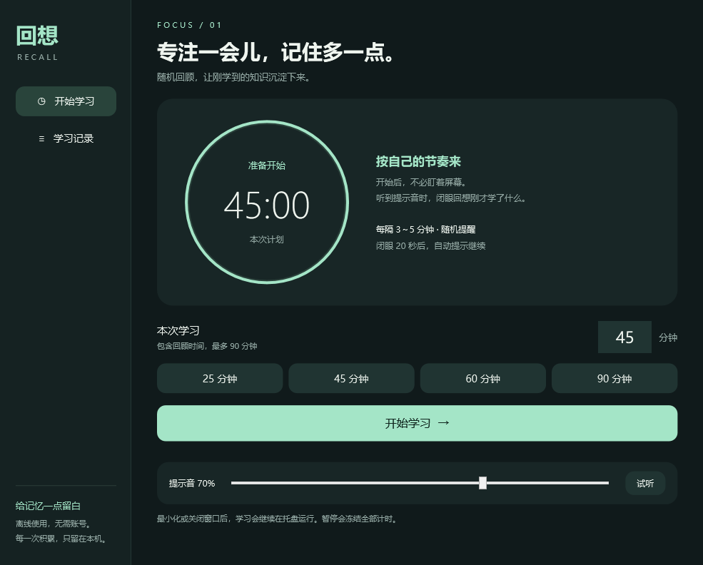
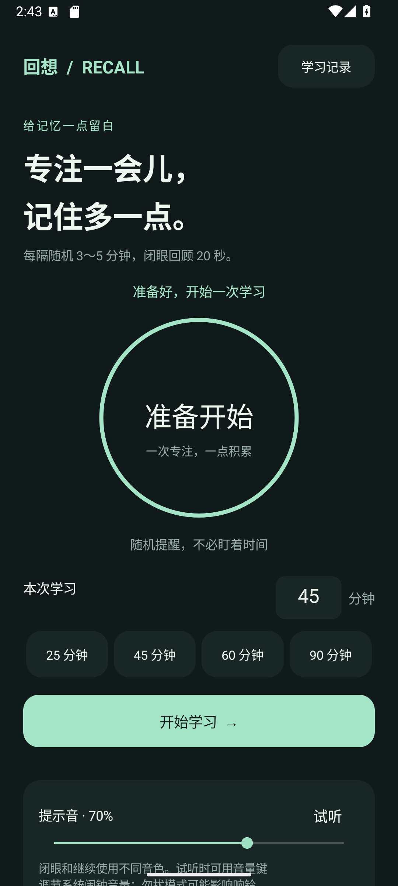

# 回想 / Recall

一个离线学习与回顾计时器，提供原生 Android App 和 Windows 桌面 EXE。无需注册，手机与电脑独立使用。

## 下载与使用

[**打开最新版本下载页**](https://github.com/wupzl/recall-study/releases/latest)

| 平台 | 安装包 | 使用方式 |
| --- | --- | --- |
| Android 8.0+ | [下载 APK](https://github.com/wupzl/recall-study/releases/download/v1.0.0/Recall-Study.apk) | 传到手机直接安装 |
| Windows 10 / 11 | [下载 Windows 压缩包](https://github.com/wupzl/recall-study/releases/download/v1.0.0/Recall-Windows.zip) | 解压，双击 `Recall-Study.exe` |

源码下载不包含安装包，请从上面的 Release 下载。自己构建时，产物在 `dist/`：

- `Recall-Study.apk`：Android 8.0 及以上，直接安装。
- `Recall-Windows.zip`：Windows 10 / 11，解压后运行 `Recall-Study.exe`，无需安装程序。
- `Recall-Study.exe`：可直接运行的 Windows 程序。旁边的 `.config` 提供运行时和高清屏设置，建议一起保留。

### 界面预览



<details>
<summary>查看 Android 界面</summary>



</details>

### Android

1. 把 APK 传到手机，打开安装；按手机提示允许该来源安装应用。
2. 打开“回想”，设置 1～90 分钟，也可选择 25、45、60、90 分钟。
3. 首次点击开始时，允许通知，并按引导允许不受电池优化限制；返回应用再次点击开始。
4. 点击“试听”，调节应用音量与手机**闹钟音量**。应用使用闹钟音频通道，勿扰设置仍可能影响声音。
5. 开始后可以锁屏或切换应用。通知栏可查看状态、暂停、继续或结束。

锁屏提醒采用前台服务和会话期间的 CPU 唤醒锁。Android 的省电模式会限制后台执行，电池优化豁免可让应用在休眠期间持有唤醒锁，参考 [Android 官方说明](https://developer.android.com/training/monitoring-device-state/doze-standby)。部分品牌还需要在系统设置中允许后台运行、自启动，或锁定后台任务。强行停止应用、系统主动终止服务或关机后无法继续提醒。这里不承诺绕过手机厂商的后台限制。

### Windows

1. 解压 `Recall-Windows.zip`，双击 `Recall-Study.exe`。
2. 设置时长、试听并调节音量，点击“开始学习”。声音同时受 Windows 的音量与输出设备设置影响。
3. 最小化窗口或在会话期间点击关闭按钮，会收起到系统托盘，学习继续运行。双击托盘图标打开窗口。
4. 托盘右键菜单提供暂停、继续、结束和退出。

学习期间会阻止电脑自动进入睡眠，允许显示器熄灭。用户手动睡眠时自动暂停；唤醒后点击继续。程序为本地生成的未签名 EXE，Windows 可能显示“未知发布者”。Windows 版本使用系统通常自带的 .NET Framework 4.8，不需要安装 .NET 10 或额外下载依赖。

## 已确认的计时规则

- 每次学习由用户设置，范围 1～90 分钟，默认 45 分钟。
- 第一次学习开始时，从 **180,000～300,000 毫秒**内均匀随机选择下一次回顾间隔；每轮重新随机，不使用固定的 3、4 或 5 分钟档位。
- 学习间隔结束：播放短提示音，自动进入 20 秒闭眼回顾。
- 回顾结束：播放不同的短提示音，自动继续学习，并重新随机选择 3～5 分钟。
- 20 秒计入本次总时长，总时长到点优先结束；最后一次回顾可能不足 20 秒。
- 暂停冻结总计时和当前阶段计时；继续时接着剩余时间，不重新随机。
- 提前结束保留已学习时长；自然结束播放完成提示音。
- 临近截止不强行插入回顾。例如 1 分钟的短会话只在结束时提示。
- 如果系统延迟回调，不连续补播已错过的声音；若尚未到总时长，回顾从实际触发时开始计 20 秒。
- 随机抽样可能自然产生相同或接近的间隔，不强行去重。

## 本地数据

记录学习开始时间、实际时长、计划时长、回顾次数、完成状态，保留最近 500 条。

- Windows：`%LOCALAPPDATA%\RecallStudy\data.json`，使用原子替换保存，保留上一版 `.bak`。
- Android：应用私有 SharedPreferences，未申请网络权限，未启用系统备份。
- 活动会话每 5 秒保存检查点。异常退出后，再次打开会把上次会话保存为“中断”，不自动补播提醒或重新开始。异常退出的记录最多可能少计最近约 5 秒。
- 手机与电脑之间不自动同步。卸载 Android 应用会清除该设备记录。

## 源码与构建

```text
android/       Java 原生 Android 界面、前台服务、计时引擎
windows/       C# WPF 界面、托盘、本地记录、计时引擎
tests/         两端共享行为轨迹与实际运行检查
build.py       本地构建、生成提示音与图标、APK 签名
dist/          交付产物
qa/            本机验证截图与结果，不包含在分发包
.keys/         本地 APK 签名密钥，不包含在分发包
```

构建环境：Windows、Python 3 + Pillow、.NET Framework 4.8 编译器、JDK 17+、Android SDK Platform 35 / Build Tools 35.0.0。设置 `JAVA_HOME` 与 `ANDROID_HOME` 后运行：

```powershell
python build.py
python build.py --only tests
python build.py --only windows
python build.py --only android
```

无需 Gradle、Maven 或 npm 下载依赖。Android 通过 aapt2、javac、D8、zipalign、apksigner 构建，采用 APK v2/v3 签名。前台服务按 [Android 14+ 的类型要求](https://developer.android.com/develop/background-work/services/fgs/service-types#special-use)声明 `specialUse`。目前交付方式为直接安装，不涉及应用商店上架。

**请私下备份 `.keys/` 文件夹**。后续 APK 更新必须使用同一密钥；不要将密钥上传公开仓库或随安装包分发。

## 验证

`build.py` 对 Java 和 C# 引擎运行相同的行为轨迹，分别包含 10,049 个断言：随机上下界与分布变化、20 秒切换、学习和回顾阶段暂停、短会话、总时长优先、迟到回调、提前结束、重新开始、90 分钟限制。

`tests/android_smoke.py` 在隔离的 Android 15 模拟器上执行真实 6 分钟会话，检查首次权限引导、暂停、继续、锁屏随机提醒、20 秒自动继续、总时长结束与完成记录。通过后输出 `qa/android-result.json`。

`tests/WindowsIntegration.cs` 驱动实际 WPF 界面，执行真实 1 分钟会话，检查输入验证、预设、学习和回顾阶段的暂停冻结、继续、托盘运行、20 秒回顾、到点完成与记录显示。仅在测试进程内部提前触发一次回顾边界，以覆盖完整界面与音频流程；正式 EXE 不包含加速控制。验证数据隔离保存至 `qa/windows-data/`，输出 `qa/windows-result.json`。

模拟器没有启用扬声器输出，不能替代手机真机对提示音可听性、厂商省电策略的验证；首次在手机使用时请先试听，并完成一轮锁屏测试。
